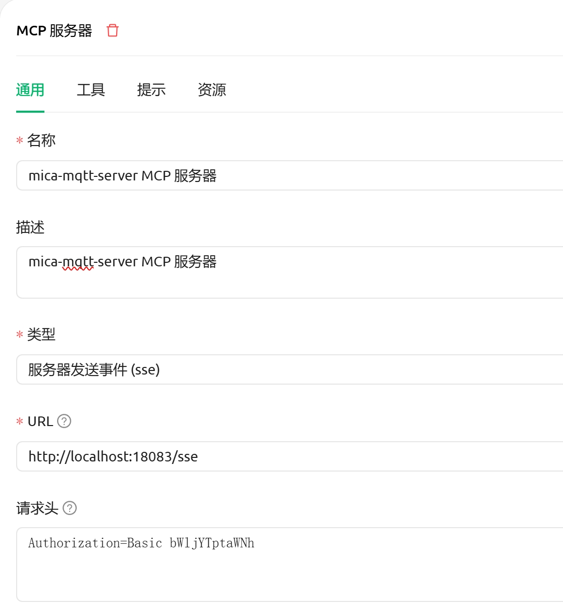
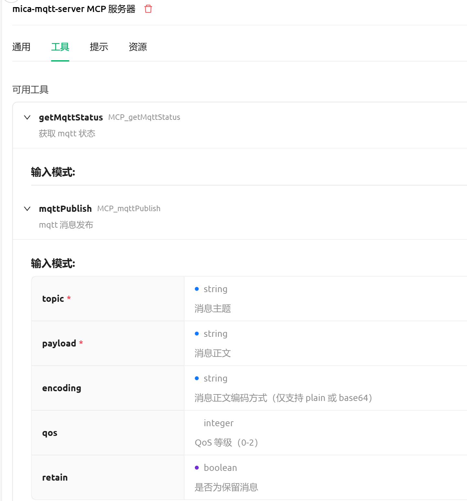
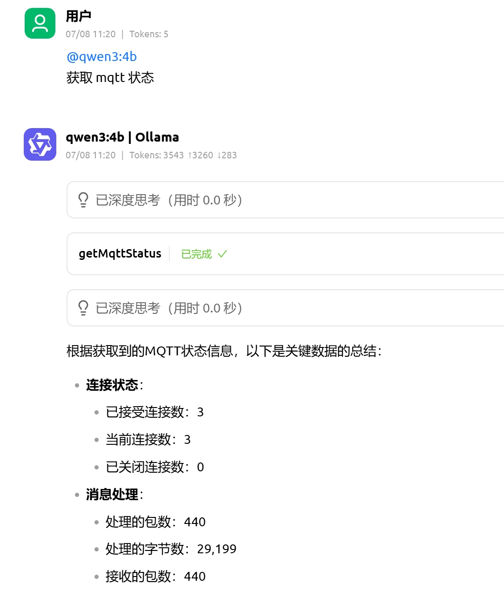
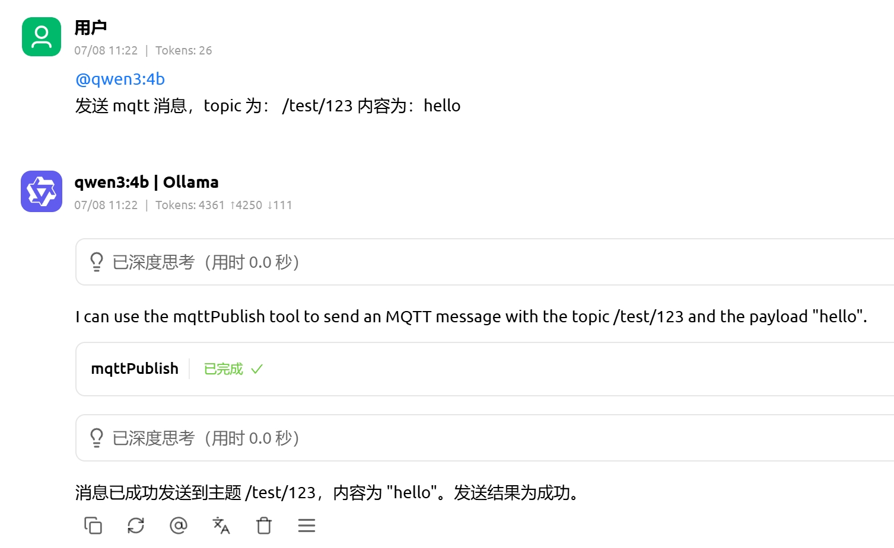

### 启用配置

在 `mica-mqtt-server-spring-boot-starter` 中，需要开启 `http-listener` 并启用 `mcp` 子配置，默认提供 3 个端点：

| 端点 | 配置项 | 默认值 | 说明 |
| --- | --- | --- | --- |
| Stream HTTP 端点 | `mqtt.server.http-listener.mcp.endpoint` | `/mcp/message` | 流式 HTTP 消息端点 |
| SSE 端点 | `mqtt.server.http-listener.mcp.sse-endpoint` | `/mcp/sse` | SSE 连接端点 |
| SSE Message 端点 | `mqtt.server.http-listener.mcp.sse-message-endpoint` | `/mcp/message` | SSE 消息端点 |

配置示例：

```yaml
mqtt:
  server:
    http-listener:
      enable: true
      port: 18083
      basic-auth:
        enable: true
        username: mica
        password: mica
      mcp:
        enable: true
        endpoint: /mcp/message          # stream http endpoint
        sse-endpoint: /mcp/sse          # sse 端点
        sse-message-endpoint: /mcp/sse/message  # sse message 端点
```



注意：请求头添加的是 mica-mqtt-server 的 http api 默认的 basic 认证的密钥。

### 工具



注意：mica-mqtt-server mcp 目前内置了 mqtt 状态和 mqtt 发布2个 tools 工具，未来会添加更多。

## 效果





## 相关文档

- [mica-mqtt-server-spring-boot-starter 使用文档](spring/server.md)
- [mica-mqtt HTTP REST API 接口文档](httpApi.md)
